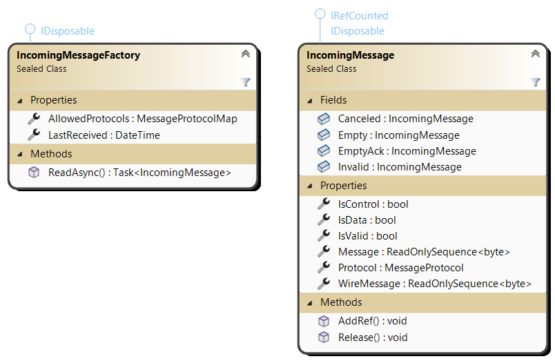
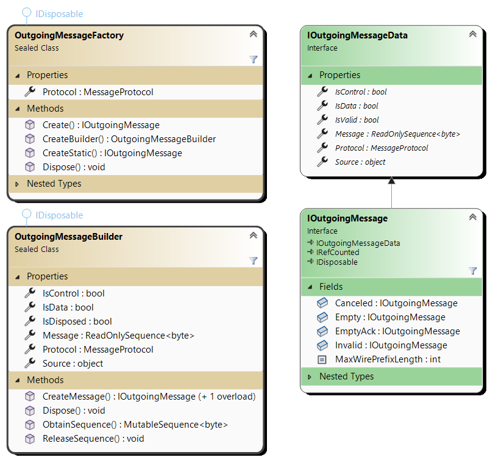
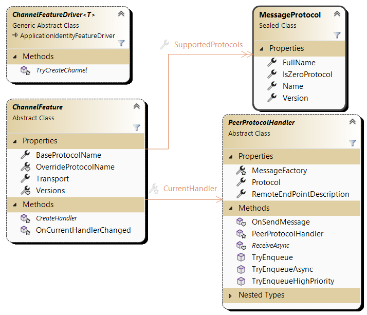

# Transport Layer

Parties modeled by CK-AppIdentity know each other by name and by pinned keys
([CK.AppIdentity.KeyManagement](../CK.AppIdentity.KeyManagement/README.md)): this package connects them. It listens and
connects, authenticates both sides with the "0 Protocol" handshake, protects every frame that follows against tampering,
and multiplexes up to 7 message protocols ("channels") on one connection. Connections come and go: a remote is a stable
[`TransportFeature`](TransportFeature.cs) that queues what is sent to it and reconnects on its own.

The transport is pluggable: `tcp:` ships here, and any [`TransportTypeService`](Transport/TransportType/TransportTypeService.cs)
can add another one (see [Transport types](#transport-types)).

## Configuration keys

`IRemoteParty.Address` is the only modeled property: it can only be defined on a RemoteParty and is optional.
When not specified, then the Remote is Client: we must act as a Server, meaning that we must listen to
incoming connections until the Remote establishes the connection. When listening to incoming connections, a
single local end point can handle connections from more than one RemoteParty: the `ListeningAddress` is a
configuration property that can be defined once, at the root level (ApplicationIdentityService), but nothing
prevents this `ListeningAddress` to be defined at any configuration level: they are combined, the closest level winning
for a given type of transport. This enables a dedicated listening address for a Domain or even for a specific Remote.

An `Address` or a `ListeningAddress` are mere strings: their exact syntax depends on the type of Transport that
must be used. This type is the prefix of the address, with the standard URI protocol syntax: it is the `TypeName` of a
registered transport type (`tcp:` here). An address without a known prefix is a `tcp:` address: `127.0.0.1:37120` is
the same as `tcp:127.0.0.1:37120`. A `tcp:` address is an IP address with an optional port that defaults to 37120.
For an encrypting transport built on this layer, see [`mtls:`](../CK.AppIdentity.Transport.MutualTls/README.md): it is
the same handshake inside a mutually authenticated TLS channel and lives in its own package.

A `ListeningAddress` property at one level can be a string, a comma separated string or an array of strings,
but when more than one address is specified, there must be only one address per type of Transport. With the `mtls:`
transport registered, this is valid: `"ListeningAddress": [ "tcp:127.0.0.1:3712", "mtls:127.0.0.1:3713" ]`.
When no `ListeningAddress` is configured at all, the party listens on the default `tcp:` address, on all interfaces
(`0.0.0.0:37120`), and a warning says so.

When a `IRemoteParty.Address` is not specified, a third and last property can be used to choose which type of
transport listener must be used: the `ListeningTypes`:
  - It can be a simple string: 'all' to allow all the  `ListeningAddress` defined above, or one of the types (like 'tcp').
  - A comma separated string or an array of strings that are the transport type names to use.
This `ListeningTypes` property defaults to 'all': the remote can freely choose the transport type to use.

Two consequences worth knowing when a party listens on more than one type. A transport type that declares a
default listening address injects it into any party that already has **two or more** configured listening
addresses — so registering a transport can open a port nobody wrote down, on a party that was already
multi-homed. And with the default 'all', a remote configured for a cleartext transport connects in the clear
and authenticates correctly even though a secured listener was available: `ListeningTypes` set to that one
type is how a deployment requires the secured one.

Other keys:

| Key | On | |
|-----|----|---|
| `AlwaysListening` | A local party | `true` opens its listeners at start. By default, they are opened when the first remote without `Address` appears. |
| `DisallowEviction` | A listened remote | `true` refuses a new incoming connection from this remote while one is alive. By default, a new connection replaces (evicts) the current one. |
| `NegotiationTimeout` | A remote we connect to | How long an outgoing connection attempt may take, in seconds (1 to 600). Defaults to `TransportManagerFeature.DefaultOutgoingNegotiationTimeout` (15 seconds). |
| `EnlistRemoteUrl` | A remote, or a tenant domain | A URL sent to a party that is unknown here, or that does not trust us, so that it can be enlisted. It is looked up from the remote, or for an unknown caller from the tenant domain that has its domain name, up through the parents. `{DomainName}` is replaced by the domain name of the caller. It is handed to unauthenticated callers. |

The "Transport" feature itself is allowed by default and requires the "KeyManagement" one on the remote.

## Messages

An incoming message is an [`IncomingMessage`](Message/Incoming/IncomingMessage.cs): a `ReadOnlySequence<byte>` with its
`Protocol`, read from a transport by the [`IncomingMessageFactory`](Message/Incoming/IncomingMessageFactory.cs). An
outgoing message is an [`IOutgoingMessage`](Message/Outgoing/IOutgoingMessage.cs): it is immutable and is created by the
[`OutgoingMessageFactory`](Message/Outgoing/OutgoingMessageFactory.cs) of its protocol, through an
[`OutgoingMessageBuilder`](Message/Outgoing/OutgoingMessageBuilder.cs) (`CreateBuilder()`), a writer delegate (`Create`)
or as a static message that needs no disposal (`CreateStatic`).

Both are reference counted (`IRefCounted`, and `Dispose()` is `Release()`): they hold pooled memory buffers that are
released when the last reference is released.

## Message Prefix: Protocol and Length

All messages exchanged by the Transport layer are prefixed by the message's protocol and length.
- The prefix starts with a first byte: `|L0|L1|CD|R0|R1|P0|P1|P2|`.
  - The 2 MSB (L0-L1) gives us the number of bytes of the message length:
    - `00` 1 byte, the message length is between 0 and 255 bytes.
    - `01` 2 bytes, the message length is between 256 and 65535 bytes.
    - `10` 3 bytes, the message length is between 65536 and 16 777 215 bytes.
    - `11` 4 bytes, the message length is between 16 777 216 and 2 147 483 647 bytes (2 GiB).
  - The `CD` bit is the "Control vs. Data" bit. This is a convenient bit that can be used by protocols
    as a one bit discriminator, typically between a regular data message and one (or more) control message.
  - `R0` and `R1` bit are reserved for future use.
  - P0-P2 bits is the Protocol, a number between 0 and 7. This number defines the "type" of the
  message: the writer or serializer that has been used to write the payload and the reader or "deserializer"
  that must be used to read it back.
- Then comes the message length itself (1 to 4 bytes, little endian)
- Then the message payload itself.
- After the handshake, the payload is followed by a 16 bytes authentication tag, counted in the length (see
  [the security model](#what-protects-the-frames-afterwards)).

At a higher level ["Protocols"](MessageProtocol.cs) are identified by a string (its unique name).
A protocol defines how the message is encoded and how they are exchanged: by merging these 2 concepts here,
we greatly simplify the implementation and the understandability of the Transport layer. The protocol simply
defines the encoding it uses. A [`MessageProtocol`](MessageProtocol.cs) has a `Name` and a `Version`: its `FullName`
is "Name.Version". The [`MessageProtocolDirectoryService`](MessageProtocolDirectoryService.cs) registers them.

The `"0 Protocol"` protocol name is reserved: this is the protocol of CK.AppIdentity.TransportLayer itself that handles
special messages used to negotiate, accept, reject incoming parties and outgoing connections.
This lets 7 possible protocols. This may seem a limitation however this limit applies to a Remote party pair: there
can be any number of possible protocols in an application, among them 2 parties that start to interact initially
negotiate the ones they can and want to use. Any Transport between 2 parties can support up to 7 different protocols
([`MessageProtocolMap.MaxCount`](MessageProtocolMap.cs)).

The declared length is chosen by the peer, so it is bounded before anything is allocated for it:
`MessageProtocol.MaxIncomingMessageLength` is 16 MiB by default (`DefaultMaxIncomingMessageLength`) and 1 MiB for the
"0 Protocol". A longer frame is invalid, which kills the transport; the sender refuses to build an outgoing message above
the same bound. The bound of a protocol is set when it is first registered (`TryRegister`'s `maxIncomingMessageLength`).

The final length of a message on the wire is between 2 bytes (the special Empty message, see below) and 2 GiB.
A minimal 1 byte message requires 3 bytes (in any of the 7 available protocols) during the handshake.

Two special public singletons exist on both `IncomingMessage` and `IOutgoingMessage` (tied to the "0 Protocol").
They never cross a frontier, they can only be used locally on a party:
- `Invalid` is the "invalid" message, used when an invalid message is received.
- `Canceled` is a second "invalid" message, that is used to signal a canceled read operation.

Two other special "0 Protocol" messages exist: `Empty` and `EmptyAck`.
They are valid messages that are exchanged to implement the KeepAlive functionality.
Before the run phase, their length on the wire is 2 bytes and they are the shortest messages that exist; in the run
phase they carry their authentication tag like any other frame. Regular protocols (other than the "0 Protocol") are not
allowed to send empty messages.

The low level buffers ([`MutableSequence<T>`](Buffering/MutableSequence.cs)) and the `FastByteReader`/`FastByteWriter`
helpers are described in [Buffering](Buffering/README.md).

## Channels

A channel is a feature of a remote that owns one message protocol. It is made of:

- a [`ChannelFeatureDriver<T>`](Channel/ChannelFeatureDriver.cs): its type name must end with "ChannelFeatureDriver", so
  that its feature name ends with "Channel". The protocol name is the feature name without "Channel" (unless
  `ChannelFeature.OverrideProtocolName` says otherwise). `TryCreateChannel` creates the channel for each remote that has a
  `TransportFeature` and allows the feature;
- a [`ChannelFeature`](Channel/ChannelFeature.cs) added to the remote: its `Versions` are the protocol versions it
  supports (none means version 0), and its `CreateHandler` creates the handler of a negotiated version;
- a [`PeerProtocolHandler`](Channel/PeerProtocolHandler.cs) per connected version: it receives the messages of its
  protocol (`ReceiveAsync`, that must eventually dispose the message) and enqueues the ones to send (`TryEnqueue`,
  `TryEnqueueAsync`, `TryEnqueueHighPriority`). `OnSendMessage` is called before each send attempt (it must be side
  effect free, it can provide a replacement message) and `OnMessageSent` once the message has actually been sent.

A remote supports at most 7 channels. For each protocol, the two parties use the highest version they both support,
and the current handler of a channel changes (`OnCurrentHandlerChanged`) when a connection appears or is lost.

For a minimal channel built on this layer, see [CK.AppIdentity.BlobChannel](../CK.AppIdentity.BlobChannel/README.md).

## Connected or not connected?
Even if CK.AppIdentity is designed to work with connected remotes, the availability of a connection between two parties is
highly instable. One major goal of this library is to be easy to use and instability brings a lot of complexities.
To minimize the impact, numerous design choices have been made but the most important one is that sent messages are
internally queued and that temporary disconnection are transparently handled.

The [`TransportFeature`](TransportFeature.cs) exposes a `Task ReadyTask { get; }` that is completed when a first connection has been successfully
established with the remote. This task can be awaited (or its [`Task.IsCompleted`](https://learn.microsoft.com/en-us/dotnet/api/system.threading.tasks.task.iscompleted)
status can be checked) before sending any data to the remote.
If the connection is lost, queued data are transmitted as soon as a new connection is available.
Obviously, pending messages cannot be collected _ad infinitum_: the queue holds at most
`TransportFeature.SenderQueueCapacity` (4096) messages; when it is full `TryEnqueue` returns false and `TryEnqueueAsync`
waits. The transport feature exposes a simplified "level of pressure"
with the ConnectionAvailability enumeration. This should be used before sending any data to a remote.

| Value | Name       | Description  |
|-------|------------|--------------|
|0      | None       | No connection at all. This is the initial state, and the state of a remote that is switched off (along with a new pending `ReadyTask`). |
|1      | DangerZone | Connected, but no longer answering: a keep-alive probe has gone unanswered. Any traffic from the remote clears it. |
|2      | Low        | A connection to a remote we connect to was lost and a reconnection is under way.  |
|3      | Connected  | The remote is connected.  |

A connection can die without either side saying so — the peer loses power, a NAT table entry
expires, a cable goes. Nothing notices on its own: reads never complete, and writes keep succeeding
into the kernel buffer. So a party that has received nothing for `KeepAliveIdleTime` asks the remote
whether it is still there, and a run of unanswered probes condemns the connection. `DangerZone` is
the warning in between — still connected, no longer answering — and is what an application should
watch to stop feeding a link that is about to go. The settings are on the
[`TransportManagerFeature`](TransportManagerFeature/TransportManagerFeature.cs): `KeepAliveIdleTime` (30 seconds,
`TimeSpan.Zero` disables keep-alive), `KeepAliveProbeInterval` (5 seconds) and `KeepAliveProbeCount` (3).

The probe and its acknowledgment are "0 Protocol" messages, so during the run phase they carry a MAC
like any other frame: an attacker who can inject bytes cannot forge an acknowledgment to hold a dead
link open.

A connection does not outlive the operational credential that authenticated the peer: once it has expired (beyond
`MaxClockOffset`), the connection is closed and the reconnection presents a fresh one.

A remote that keeps accepting the connection and then dropping it is retried with a growing delay: its `FlapCount`
counts the connections that did not last `TransportManagerFeature.StableConnectionTime` (one minute), and the delay
doubles up to `MaxFlapReconnectDelay` (30 heartbeats).

`SwitchOff( reason )` and `SwitchOn()` take a remote off line and back: a switched off remote tells the other side why
when it connects or when the current connection closes. The `TransportManagerFeature.TransportChanged` and
`ConnectionAvailabilityChanged` events relay what happens to every remote.

## Peering issues

When two parties cannot connect for a reason an operator can fix, the
[`TransportManagerFeature`](TransportManagerFeature/TransportManagerFeature.cs) (a feature of the
`ApplicationIdentityService`) maintains a [`PeeringIssue`](TransportManagerFeature/PeeringIssue.cs) for the remote (see
`GetPeeringIssues()`, `Find( fullName )` and the `PeeringIssueChanged` event). Its
[`PeeringIssueKind`](TransportManagerFeature/PeeringIssueKind.cs) says what is wrong: an unknown caller, a clock offset,
two initiators, a disallowed or unsupported transport, a switched off or evicted remote, missing protocols, or keys that
one side or both do not trust yet. A listener keeps at most `MaxUnknownRemoteCount` issues for callers it does not know.

- **Approving a key.** A `RequiresLocalApproval` or `RequiresBothApproval` issue carries the identity the other side
  presented (`RemoteIdentityForApproval`). `AcceptRemoteIdentity` pins it. Nothing in the protocol proves that this key
  belongs to the named party: an approval UI must show `RemoteKeyFingerprintForApproval` and have it compared out of band.
- **Enlisting.** `EnlistUrl` is the URL the other side sent so that it can enlist us. `IsEnlistUrlAuthenticated` is false
  when it came in a reply that is not signed by a key we trust: following it is then a trust decision, never automatic.

## Key events

Right after a rotation, a recovery or a decommission (`KeyManagementFeatureDriver.KeyEventAppended`), the new key events
of a local party are pushed to its connected remotes, that move their pin at once. A party that sees an
`UnknownIssuer` signature of a remote can also ask for them: `TransportFeature.RequestKeyEventsAsync( timeout )`.

## Transport types

A transport type is an [`ITransportTypeService`](Transport/TransportType/ITransportTypeService.cs) (a multiple singleton
auto service) implemented by specializing [`TransportTypeService`](Transport/TransportType/TransportTypeService.cs):

- its `TypeName` is the address prefix (lowercase ASCII letters and digits, never "all");
- `ParseAddress` parses the typed part of an address, `DefaultListeningAddress` is optional;
- `TryCreateListener` creates a [`TransportListener`](Transport/TransportType/TransportListener.cs), that calls
  `OnIncomingTransport` for each accepted connection;
- `TryConnectAsync` connects to a remote and returns a [`Transport`](Transport/Transport.cs), whose implementation only
  sends and receives bytes (`SendAsync`, `ReceiveAsync` or `ReadExactlyAsync`, `DisposeAsync`).

A transport that presents a certificate reports it with `Transport.LocalCertificateBinding` and
`RemoteCertificateBinding` (see [Binding a secured transport to the identity](#binding-a-secured-transport-to-the-identity)).
A listener that does expensive work before `OnIncomingTransport` (a TLS handshake) must take its admission slot first
(`TryReserveIncomingSlot`) and enforce `IncomingNegotiationTimeout` itself, over both phases.

**Admission control.** Incoming connections that have not authenticated yet cost work on a stranger's say-so: at most
`TransportManagerFeature.MaxConcurrentNegotiation` (64) of them negotiate at once, `MaxConcurrentNegotiationPerSource` (16)
from one source address, and one has 2 seconds (`TransportManager.IncomingNegotiationTimeout`) to complete. Beyond the
caps, connections are closed without being read.

## The handshake

The "0 Protocol" negotiation is detailed in [TransportManager/BackTasks](TransportManager/BackTasks/README.md).

## Security model

Two parties that talk over this layer authenticate each other, and everything they then exchange is
protected against tampering. **Nothing is encrypted.** That is a requirement, not a gap, and the rest
of this section says exactly what it does and does not buy you.

### At a glance

Every connection between two parties is mutually authenticated with pinned public keys, and every frame
after the handshake is protected against tampering, injection, replay and reordering. There is no
certificate authority to run or to trust. Confidentiality is chosen per remote: `tcp:` keeps payloads
readable on purpose, so that deployments can audit their own traffic; the
[`mtls:`](../CK.AppIdentity.Transport.MutualTls/README.md) transport, built on this layer, encrypts them. The two columns
compare them because a deployment chooses between them:

| Property | `tcp:` (default port 37120) | `mtls:` (default port 37121) |
|---|---|---|
| Mutual authentication | Signed handshake against pinned keys | The same handshake, bound to the TLS certificates |
| Integrity of every frame | 128-bit MAC per frame (AES-GMAC or HMAC-SHA256) | TLS, plus the same per-frame MAC |
| Confidentiality of payloads | **None, by design** | TLS 1.2 / 1.3 |
| A relay or TLS-terminating middlebox | Fails: the session keys come from the handshake | Fails: each side signs the hash of the certificate it presented |
| Certificates to manage | None | None: derived from each party's identity key |
| Visible to an observer | Who talks to whom, when, how much, and the payloads | Who talks to whom, when, how much |

Both run side by side; `ListeningTypes` restricts a party to the encrypted one.

### Design lineage

None of the mechanisms is new; the design combines proven ones without a certificate authority.

| Stack | What this design shares with it | Where it differs |
|---|---|---|
| [TLS 1.3](https://www.rfc-editor.org/rfc/rfc8446) with client certificates | Mutual authentication, ephemeral ECDH, per-record integrity | No CA: identities are pinned keys. The identity survives a TLS-terminating middlebox (certificate binding inside the signed handshake). |
| [SSH](https://www.rfc-editor.org/rfc/rfc4251#section-4.1) | A local database of pinned host keys, optional acceptance of an unknown key on first connection | First-use trust is off by default (`AutoTrustKey.Never`), and a key presented on first contact is only ever *self-asserted*, never *trusted*, until it is pinned. Keys rotate under a pre-committed successor. |
| [WireGuard](https://www.wireguard.com/protocol/) (Noise IK) | Statically known peer keys, a fresh ephemeral key exchange per session | ECDSA / ECDH P-256 instead of Curve25519. Encryption is a per-link choice, not always on. |
| [KERI](https://arxiv.org/abs/1907.02143) (Key Event Receipt Infrastructure) | A chained [key event log](https://identity.foundation/keri/docs/Glossary.html), pre-rotation, a recovery key, [duplicity](https://identity.foundation/keri/docs/Glossary.html) as proof of compromise, "first seen" | Pinning between known parties: no witnesses or watchers network. |
| [SPIFFE / SPIRE](https://spiffe.io/docs/latest/spiffe-about/overview/) | Short-lived credentials certified by a longer-lived identity | No central issuing server: each party certifies its own operational keys. |
| [TLS 1.3 integrity-only suites (RFC 9150)](https://www.rfc-editor.org/rfc/rfc9150), [IPsec ESP with NULL encryption (RFC 2410)](https://www.rfc-editor.org/rfc/rfc2410) | Authenticated but readable traffic | Integrity-only is what `tcp:` does; `mtls:` adds encryption on the same identities. |

### What the handshake gives you

Each party owns an ECDSA P-256 identity key, proven by its key event log
([CK.AppIdentity.KeyManagement](../CK.AppIdentity.KeyManagement/README.md)). The "0 Protocol" handshake has both sides
sign a transcript covering their identity, a nonce and a timestamp, with a short-lived operational credential issued by
the identity key. Each verifies the other against what it already trusts for that remote: the key event it pins, stored as
the remote's `Identity.{Seq}.trust` file, acquired by configuration, by an operator's approval, or by `AutoTrustKey` on
first contact. A remote that rotated presents the events that link its new key to the pinned one.

A signature that verifies against a key the sender supplied in the same message proves only that the
sender holds *some* private key. That is a trust-on-first-use decision, not a proof of identity, and
the code keeps the two apart (`SignatureCheck.SelfAsserted` versus `SignatureCheck.Trusted`). An
operator confirming such a key should compare its fingerprint out of band —
`IPublicKeyData.GetFingerprint()` exists for that.

Replays are refused: a nonce is single use per remote, and a message whose timestamp falls outside
`IRemoteKeys.MaxClockOffset` is rejected. The nonce is checked once the signature has verified, so that unsigned noise
cannot flush the replay cache.

### What protects the frames afterwards

Authenticating the peer at connection time and stopping there would leave every subsequent frame
unprotected. The handshake therefore also carries an ephemeral ECDH exchange; both sides derive two
directional session keys from it and authenticate **every** run-phase frame with a 128-bit MAC
covering the header and the payload, over a counter that never repeats within a session.

So, after the handshake, an attacker on the path cannot inject a frame, alter one, reorder or replay
one, or retarget it at another protocol — any of those fail the MAC and the connection is dropped.

This also binds the session to the AppIdentity handshake itself, which matters for relays: a relay
holding two individually valid connections cannot derive the session key, so every frame it forwards
fails its MAC.

The MAC is AES-GMAC when both machines run AES in hardware, HMAC-SHA256 truncated to 128 bits otherwise
([`MacAlgorithm`](TransportManager/MacAlgorithm.cs)). `TransportFeature.NegotiatedMacAlgorithm` and `SessionId` tell what
the current connection uses.

### What is deliberately NOT protected: confidentiality

Over `tcp:`, **message payloads travel in clear and anyone who can see the traffic can read them.**

This is deliberate. Being able to read every packet crossing the network is an operational
requirement for deployments that audit their own traffic, and auditing needs only that packets be
readable. Encrypting payloads by default would remove that, so this layer does not.

What this means when you build on it:

- Do not put a secret in a payload sent over `tcp:` and expect the transport to keep it. Passwords,
  tokens, personal data, business secrets — if it must not be read by whoever can see the wire, the
  application has to encrypt it before handing it over, or it must not travel over `tcp:`.
- Integrity is not confidentiality. "The frame is authentic" says an attacker cannot *change* it. It
  says nothing about who can *read* it.
- Traffic analysis is available to an observer regardless: who talks to whom, when, how often, and
  how large each message is. Frame lengths are in clear even for the handshake.
- An observer can read the identity keys exchanged in the handshake. They are public keys; this
  costs nothing beyond telling the observer which parties are talking.

A transport that does encrypt — [`mtls:`](../CK.AppIdentity.Transport.MutualTls/README.md), built on this layer and
selected per remote by address — is the answer for deployments that need confidentiality, and it coexists with
`tcp:` rather than replacing it. The two requirements are genuinely opposed, so the choice belongs to
whoever configures the remote.

### Binding a secured transport to the identity

A transport that terminates TLS, or anything else that authenticates a peer at its own layer, must say
so inside the handshake or the two authentications remain independent — two locks on one door, and an
attacker picks whichever is easier.

`Transport.LocalCertificateBinding` and `RemoteCertificateBinding` are how that is done. A transport
that presents a certificate reports the SHA-256 of what it presented and of what it received; the
handshake carries the first inside the signed transcript and checks the peer's against the second.
Anything terminating the channel in between has to present a certificate of its own, and cannot make
either peer sign a statement about a certificate that peer never held.

A transport that presents nothing leaves both empty, which is the `tcp:` case: both sides then agree
that nothing is bound, and the field costs one byte. The asymmetric cases — one side stating a
certificate, the other having received none — are refused as invalid data, which is what makes a
transport mismatch visible instead of silently half-working.
